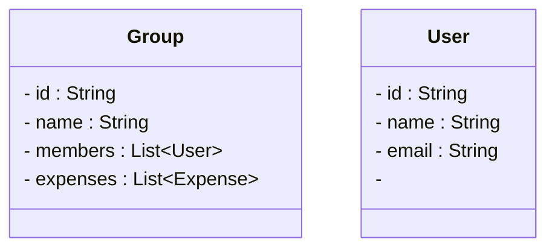

# Designing Splitwise

## Requirements
- User can create group and add members
- User can add expense and select who paid
- Expense can be split equally or by percentage
- The system calculates balances between the members
- User can view their debts

### Core Entities

- Group and Members



## Class Diagram

```mermaid
classDiagram
    class SplitwiseService {
        -SplitwiseService instance
        -Map~String, User~ users
        -Map~String, Group~ groups
        +getInstance() : SplitwiseService
        +addUser(User)
        +addGroup(Group)
        +addExpense(String, Expense)
        +settleBalance(String, String)
    }

    class User {
        -String id
        -String name
        -String email
        -Map~String, Double~ balances
        +User(String, String, String)
        +getId() : String
        +getName() : String
        +getEmail() : String
        +getBalances() : Map~String, Double~
    }

    class Group {
        -String id
        -String name
        -List~User~ members
        -List~Expense~ expenses
        +Group(String, String)
        +addMember(User)
        +addExpense(Expense)
        +getId() : String
        +getName() : String
        +getMembers() : List~User~
        +getExpenses() : List~Expense~
    }

    class Expense {
        -String id
        -double amount
        -String description
        -User paidBy
        -List~Split~ splits
        +Expense(String, double, String, User)
        +addSplit(Split)
        +getId() : String
        +getAmount() : double
        +getDescription() : String
        +getPaidBy() : User
        +getSplits() : List~Split~
    }

    class Split {
        <<abstract>>
        -User user
        -double amount
        +Split(User)
        +getUser() : User
        +getAmount() : double
        +setAmount(double)
    }

    class EqualSplit {
        +EqualSplit(User)
    }

    class PercentSplit {
        -double percent
        +PercentSplit(User, double)
        +getPercent() : double
    }

    class ExactSplit {
        +ExactSplit(User, double)
    }

    class Transaction {
        -String id
        -User sender
        -User receiver
        -double amount
        +Transaction(String, User, User, double)
    }

    SplitwiseService --> User
    SplitwiseService --> Group
    Group --> User
    Group --> Expense
    Expense --> Split
    Split <|-- EqualSplit
    Split <|-- PercentSplit
    Split <|-- ExactSplit
    SplitwiseService --> Transaction